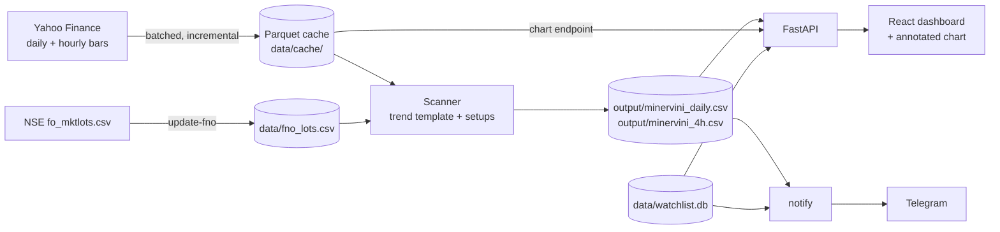

# Architecture

## Overview

- **GitHub Actions** runs the scan every weekday evening, commits `output/*` and `data/fno_lots.csv`, and sends the Telegram digest. The Parquet cache is kept between runs with `actions/cache`.
- **Locally**, the dashboard reads the committed CSVs. The chart endpoint reads the local Parquet cache and downloads a symbol on demand when its cache is missing or older than six hours.

## Python package `src/minervini_scanner/`

| Module | Responsibility |
|---|---|
| `store.py` | `MarketDataStore`: one Parquet file per symbol and interval; incremental batched downloads (`YahooBatchDownloader`), overlap check that triggers a full re-download after split/dividend re-adjustment, 1-year fallback for recently listed stocks' hourly data |
| `data.py` | Symbol list loading, 4H resampling (09:15 / 13:15 IST), rebuilding late daily bars from hourly bars |
| `indicators.py` | Moving averages, 52-week levels, weighted momentum and RS percentile |
| `rules.py` | Minervini trend-template checklist |
| `setups.py` | Swing detection, base/contraction analysis, VCP rule, stages, setup score, presets |
| `scanner.py` | Orchestrates refresh → trend template → setups → RS ranking → CSV/XLSX export |
| `fno.py` | NSE F&O lot sizes: parse, download, snapshot |
| `notify.py` | Telegram digest building and sending |
| `journal.py` | Replays the detector as of past dates (`journal-check`) |
| `watchlist.py` | SQLite watchlist |
| `api.py` | FastAPI endpoints |
| `cli.py` | Typer CLI (`minervini …`) |
| `config.py` | Settings (environment prefix `MINERVINI_`, `.env` supported) |

## Frontend `frontend/src/`

| File | Responsibility |
|---|---|
| `App.tsx` | Controls, views, table, tags, stock popup, watchlist |
| `StockChart.tsx` | Annotated chart built with TradingView Lightweight Charts (v5): candles, volume pane, EMA10/20, SMA50/150/200, base lines, contraction zig-zag, pivot/stop lines, markers |
| `styles.css` | Styling |

## Data files

| Path | In git | Content |
|---|---|---|
| `nse_symbols.csv` | yes | Scan universe: every NSE EQ-series stock (~2,400), refreshed nightly by `update-universe` |
| `data/fno_lots.csv` | yes | F&O stocks and nearest-expiry lot size |
| `data/watchlist.db` | yes | Watchlist (SQLite) |
| `data/cache/1d/*.parquet`, `data/cache/1h/*.parquet` | no | OHLCV cache (~320 MB for ~2,400 symbols; hourly bars only for liquid stocks) |
| `output/minervini_{daily,4h}.{csv,xlsx}` | yes | Scan results |

### Scan result columns

Trend template: `Price`, `MA50/150/200`, `MA200 slope %`, `52W High/Low`, `% Above 52W Low`, `% Below 52W High`, `RS Rating`, `Score` and the nine checklist booleans.

Setup: `Stage`, `Setup`, `Setup Score`, `Pivot`, `Stop`, `Risk %`, `% From Pivot`, `Entry Zone`, `Base Start`, `Base Bars`, `Base Depth %`, `Prior Rally %`, `Contractions`, `Shakeout`, `Volume Dry-up`, `Tightness %`, `Breakout Date`, `Breakout Volume x`, `Setup Notes`.

Hints and liquidity: `1H Stage`, `1H Pivot`, `1H % From Pivot`, `1H Setup Score`, `F&O`, `Lot Size`, `Avg Value (Cr)`, `Liquid`.

Rows are sorted by stage (Breakout, Ready, Recent breakout, …), then setup score, trend score and RS.

## API

| Endpoint | Purpose |
|---|---|
| `GET /api/health` | Health check |
| `GET /api/stocks` | Scan rows. Query: `timeframe` (`daily`/`4h`), `min_score` (default 7), `min_rs` (default 60), `search`, `stages` (comma-separated), `min_setup_score`, `liquid_only` |
| `GET /api/stocks/{symbol}` | One scan row |
| `GET /api/chart/{symbol}` | Candles, moving averages and the detected setup geometry. Query: `timeframe`, `bars` (default 260; always extended to include the whole base) |
| `GET /api/watchlist` · `POST`/`DELETE /api/watchlist/{symbol}` | Watchlist |

## CLI

| Command | Purpose |
|---|---|
| `minervini update` | Daily + 4H scan (refreshes daily and hourly bars once) |
| `minervini scan -t daily\|4h` | Single timeframe |
| `minervini notify [--dry-run]` | Telegram digest (`TELEGRAM_BOT_TOKEN`, `TELEGRAM_CHAT_ID`) |
| `minervini update-fno` | Refresh `data/fno_lots.csv` from NSE |
| `minervini journal-check FILE` | Detector state at past `symbol,date` rows |
| `minervini api` | Start the backend |

## Settings

Environment variables with prefix `MINERVINI_` (or `.env`): `DATA_DIR`, `OUTPUT_DIR`, `WATCHLIST_DB`, `FNO_FILE`, `RS_THRESHOLD` (trend-template rule, default 70), `MIN_SCORE`, `REQUEST_DELAY` (pause between Yahoo batches), `MIN_TRADED_VALUE_CR`, `MIN_PRICE`.

## Automation

| Workflow | Trigger | Steps |
|---|---|---|
| `ci.yml` | push / PR to `main` | Ruff lint, Ruff format check, pytest |
| `daily-scan.yml` | weekdays 12:30 UTC (18:00 IST), manual | restore Parquet cache → refresh F&O list (best effort) → `minervini update` → commit results → Telegram digest (best effort) |
